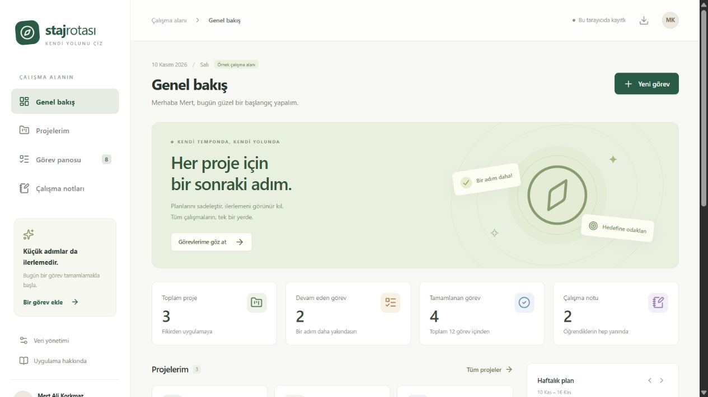

# Staj Rotası

**Mert Ali Korkmaz · Software Persona · Yapay Zeka Destekli Web Geliştirme Projesi**

Staj Rotası, staj boyunca yürütülen projeleri, görevleri ve öğrenme notlarını bir arada tutan kişisel bir web uygulamasıdır. İlk açılışta örnek verilerle başlar. Kullanıcı kendi projelerini ekleyebilir veya **Veri yönetimi** üzerinden boş bir alan açabilir.

- **Canlı uygulama:** https://staj-rotasi-mert.mattemaxim1.chatgpt.site
- **Public GitHub deposu:** https://github.com/merttro/staj-rotasi
- **Yönerge eşleştirmesi ve teslim:** [docs/TESLIM.md](docs/TESLIM.md)
- **Yapay zeka kullanımı:** [docs/YAPAY_ZEKA_SURECI.md](docs/YAPAY_ZEKA_SURECI.md)



## Özellikler

- Proje ekleme, düzenleme ve bağlı kayıtlarıyla birlikte onaylı silme.
- Görev oluşturma, hedef tarih ve öncelik belirleme.
- Yapılacak, Devam ediyor ve Tamamlandı sütunları arasında durum değiştirme.
- Projeye, önceliğe, metne ve takvim gününe göre görev filtreleme.
- Öğrenme notları ekleme, düzenleme, arama ve silme.
- Görevlerden hesaplanan proje ilerlemesi, genel ilerleme ve haftalık görünüm.
- LocalStorage ile tarayıcıda kalıcı kayıt.
- JSON yedeği indirme, doğrulanmış yedeği onayla geri yükleme.
- Boş veya örnek verili çalışma alanına geçiş.
- Dar ekranlara uyumlu düzen, klavye odağı, etiketli alanlar ve yerel dialog pencereleri.

Uygulama bir sohbet botu veya tahmin modeli içermez. Yönergedeki yapay zeka desteği **geliştirme sürecinde** OpenAI Codex ile sağlanmıştır.

## Kullanılan teknolojiler

| Teknoloji                  | Kullanım                                               |
| -------------------------- | ------------------------------------------------------ |
| React 19                   | Bileşenler ve arayüz durumu                            |
| TypeScript                 | Veri tipleri ve derleme zamanı kontrolleri             |
| Vinext ve Vite             | React uygulamasının geliştirme ve üretim derlemesi     |
| Saf CSS                    | Renkler, düzen, responsive kırılımlar ve odak stilleri |
| Lucide React               | Arayüz ikonları                                        |
| LocalStorage               | Her ziyaretçinin kendi tarayıcısındaki veriler         |
| Node test runner           | Veri kuralları için otomatik testler                   |
| Sites / Cloudflare Workers | Canlı yayın                                            |

Vinext, Next.js App Router düzeniyle uyumlu Vite tabanlı bir araçtır. Hazır Sites altyapısındaki yardımcı dosyalar yayınlama için korunmuştur. Uygulamanın kendi kodu aşağıdaki birkaç dosyada toplanır.

## Kurulum

Node.js **22.13 veya üzeri** ve npm gerekir. Depoyu klonlayın:

```bash
git clone https://github.com/merttro/staj-rotasi.git
cd staj-rotasi
npm ci
npm run dev
```

Terminalde gösterilen `http://127.0.0.1:5173` adresini açın. Kurulum ilk defa yapılırken internet gerekir. Veriler bu adresin tarayıcı depolamasına kaydedilir. `localhost`, `127.0.0.1` ve canlı alan adı farklı depolama alanları kullanır.

```bash
npm test
npm run typecheck
npm run build
npm start
```

`npm start`, başarılı derlemeden sonra yerel üretim sunucusunu çalıştırır. Dev sunucusu ve üretim sunucusu aynı anda kullanılacaksa aynı portu kullanmadıklarından emin olun.

## Dosya yapısı

```text
app/
  page.tsx                Ana sayfa girişi
  layout.tsx              Dil ve sayfa metadata bilgileri
  globals.css             Arayüz ve responsive stiller
components/
  staj-app.tsx            Ekranlar, filtreler, kayıt ve uygulama akışı
  planner-forms.tsx       Proje, görev, not formları ve dialog
  planner-cards.tsx       Tekrar kullanılan proje ve görev kartları
lib/
  planner.ts             Veri modeli, yedek doğrulama ve hesaplama kuralları
tests/
  planner.test.mjs        Veri kurallarını sınayan altı test
docs/
  TESLIM.md              Teslim bağlantıları ve yönerge karşılıkları
  YAPAY_ZEKA_SURECI.md    Plan, örnek istemler ve doğrulama yaklaşımı
  KODU_ANLAMA.md          Kodun başlangıç seviyesinde açıklaması
  TESTLER.md             Gerçekten yürütülen kontroller
  genel-bakis.jpg        Gerçek uygulama ekran görüntüsü
scripts/                 Hazır geliştirme ve Sites yayın yardımcıları
.openai/hosting.json      Bu Site'ın yayın kimliği
```

## Veri modeli

Bir çalışma alanı `version: 1` ve `app: "staj-rotasi"` alanlarıyla sürümlenir.

- `Project`: kimlik, başlık, açıklama, kategori ve renk.
- `Task`: kimlik, başlık, açıklama, proje kimliği, durum, öncelik ve hedef tarih.
- `Note`: kimlik, başlık, içerik, isteğe bağlı proje kimliği ve güncellenme zamanı.

İlerleme, tamamlanan görev sayısının toplam görev sayısına oranıdır. Görevsiz projede sıfır gösterilir. Gecikmiş görev, tarihi bugünden önce olan ve tamamlanmamış görevdir. Tarihler cihazın yerel takvim gününe göre değerlendirilir.

`validateWorkspace`, depolamadan ve dosyadan gelen veriyi doğrular. Kimlikler, izin verilen durumlar, tarih biçimi, ilişkiler ve uzunluklar kontrol edilir. En fazla 100 proje, 1.000 görev ve 500 not kabul edilir. Yedek yükleme boyut sınırı 600 KB'dir. Proje silme işlemi o projeye bağlı görev ve notları da kaldırır; kullanıcıya silmeden önce sayı gösterilir.

## Verilerin saklanması

LocalStorage anahtarı `staj-rotasi.workspace.v1`'dir. Proje ve görev verileri bir veritabanına gönderilmez. Sunucu, sayfayı ve JavaScript/CSS dosyalarını sunar. Hesap girişi ve cihazlar arasında otomatik eşitleme yoktur. Aynı uygulamayı ziyaret eden kişiler birbirlerinin kayıtlarını görmez.

Tarayıcı verilerini temizlemek kayıtları siler. Önce **Veri yönetimi > Yedeği indir** ile JSON dosyası alın. Başka cihazda **Yedek yükle** ile dosyayı seçip **Yedeği uygula** düğmesiyle onaylayın. Yükleme mevcut alanın tamamının yerine geçer. Tek sekmede kullanılması önerilir; eş zamanlı sekmelerde çakışma birleştirme uygulanmaz.

Bozuk bir LocalStorage kaydı okunamazsa uygulama bunu otomatik olarak örnek verilerle ezmez. Uyarı gösterir ve açık bir yedek yükleme/yeniden başlangıç işlemi bekler. Depolama izni veya kota sorunu yaşanırsa kayıt uyarısı gösterilir ve indirilebilir yedek kullanılabilir.

## Yayınlama

Canlı sürüm Sites üzerinde yayınlanır. `.openai/hosting.json`, kayıtlı Site kimliğini içerir; bir erişim anahtarı değildir. Site'ın kaynak sürümü commit ile eşleştirilerek üretim çıktısıyla birlikte yayınlanır. GitHub deposu aynı uygulamanın açık kaynak dosyalarını ve ekran görüntülerini barındırır. Yayın token'ları veya kişisel JSON yedekleri depoya eklenmez.

Başka bir Cloudflare hesabında yayınlamak için kendi Worker/Site projenizi oluşturup onun yapılandırmasını kullanmanız gerekir. Mevcut Site kimliğine sahip olmak düzenleme yetkisi vermez. Uygulama mantığı tarayıcıda çalıştığından farklı bir React/Vite barındırmasına taşınabilir; bu sürümün hazır derleme akışı Sites/Workers içindir.

## Sınırlamalar ve geliştirme fikirleri

- Tek kullanıcı ve tek tarayıcı depolaması odaklıdır.
- Çevrimdışı yeniden açma için service worker veya PWA kurulumu yoktur.
- Görev durumları seçim kutusuyla değiştirilir; sürükle-bırak uygulanmaz.
- Kullanıcı adı bir hesap sistemi değildir; proje sahibi bilgisi olarak gösterilir.
- Gelecekte isteğe bağlı kullanıcı hesabı, eşitleme, erişilebilir sürükle-bırak ve çalışma süresi takibi eklenebilir.

Bu proje eğitim amacıyla OpenAI Codex desteğiyle hazırlanmıştır. Kod ve paket bağımlılıklarının kendi lisansları geçerlidir; kaynak kod için ayrıca bir lisans seçilmemiştir.

## Diğer ekran görüntüleri

- [Görev panosu](docs/gorev-panosu.jpg)
- [Mobil genel bakış](docs/mobil.jpg)
